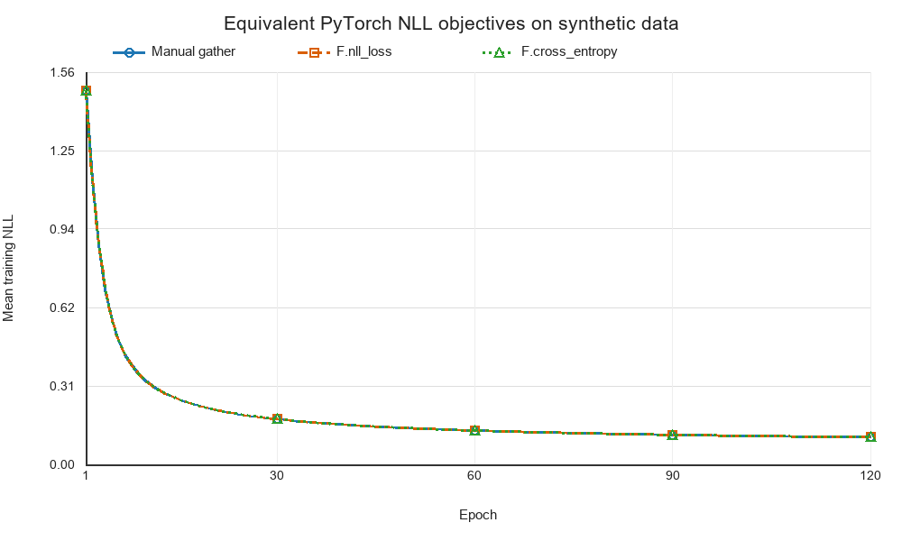

# NLL 的稳定实现与训练验证

## 摘要

负对数似然（negative log-likelihood, NLL）把模型分配给正确类别的概率转化为可优化的标量损失。本实验说明从 logits 计算 NLL 的两种 PyTorch 接口：先使用 `log_softmax` 得到对数概率，再交给 `nll_loss`；或将 logits 直接交给 `cross_entropy`。固定 logits 实验中，两种内置接口与基于 `gather` 的手工计算得到相同损失和梯度。一个三分类线性模型在固定随机种子的合成数据上训练 120 轮，三条训练轨迹重合，最终测试准确率均为 100%。另一个变长序列例子验证了下一词标签移位和 padding 忽略后的 token 平均。极端 logits 检查显示，先算 softmax 再取对数会产生非有限值，而 `log_softmax` 保持有限。

## 1. 问题与原理

分类模型对输入样本 xₙ 输出每个类别的未归一化分数，即 logits。Softmax 将它们归一化为条件概率；若真实标签为类别 yₙ，最大似然估计等价于最小化真实类别概率的负对数。PyTorch 的 `NLLLoss` 接收对数概率；对整数类别标签，`CrossEntropyLoss`/`cross_entropy` 接收 logits，并将对数 softmax 与 NLL 组合计算。这里比较的条件为无类别权重、无标签平滑和相同的均值归约；概率型软标签等其他设置不包含在该等价性实验中。接口约定见 PyTorch 官方 [NLLLoss](https://docs.pytorch.org/docs/2.14/generated/torch.nn.NLLLoss.html) 和 [cross_entropy](https://docs.pytorch.org/docs/2.14/generated/torch.nn.functional.cross_entropy.html) 文档。

对一个含 C 类的分类问题，第 n 个样本在类别 c 上的概率为：

$$
p_{n,c}=\frac{\exp(z_{n,c})}{\sum_{j=1}^{C}\exp(z_{n,j})}.
$$

直接计算指数再取对数可能在数值上溢出或下溢。令 mₙ 为该样本全部 logits 的最大值，稳定的 log-softmax 写作：

$$
\log p_{n,c}=(z_{n,c}-m_n)-\log\sum_{j=1}^{C}\exp(z_{n,j}-m_n).
$$

PyTorch 官方说明，`log_softmax` 使用等价但数值更稳定的计算，而不是把 `softmax` 与 `log` 分开执行（[log_softmax 文档](https://docs.pytorch.org/docs/2.14/generated/torch.nn.functional.log_softmax.html)）。标签为 0 到 C−1 之间的整数时，单样本 NLL 只取真实类别对应的对数概率：

$$
\ell_n=-\log p_{n,y_n}.
$$

默认的未加权批次均值为：

$$
\mathcal{L}_{\mathrm{NLL}}=\frac{1}{N}\sum_{n=1}^{N}\ell_n.
$$

因此，手工实现可先执行 `F.log_softmax(logits, dim=1)`，再用 `gather(dim=1, index=targets[:, None])` 选择每个样本真实类别的对数概率并取负均值。等价的内置写法是 `F.nll_loss(F.log_softmax(logits, dim=1), targets)`；若模型输出原始 logits，则可直接使用 `F.cross_entropy(logits, targets)`。对单一正确类别标签，交叉熵的 one-hot 形式与上述 NLL 相同。

```python
log_probs = F.log_softmax(logits, dim=1)  # logits: [batch, classes]
manual_nll = -log_probs.gather(1, targets[:, None]).mean()
nll_loss = F.nll_loss(log_probs, targets)
cross_entropy = F.cross_entropy(logits, targets)  # accepts raw logits
```

模型输出与损失通过自动微分连接。以本实验的线性分类器为例，输入为二维向量，模型计算三个类别的 logits，学习参数为权重矩阵 W 和偏置 b：

$$
z_n=Wx_n+b,\qquad W\in\mathbb{R}^{3\times2},\quad b\in\mathbb{R}^{3}.
$$

对未加权批次均值，NLL 对单个 logit 的导数等于预测概率减去真实标签指示值，再除以样本数 N；梯度继而传回 W、b。训练循环因此需先清除上一步梯度，计算损失并反向传播，再由优化器更新参数。下面是与实验一致的核心流程；替换 loss 的等价计算路径即可比较三种实现。

```python
model = torch.nn.Linear(2, 3)
optimizer = torch.optim.SGD(model.parameters(), lr=0.2)
for epoch in range(120):
    optimizer.zero_grad(set_to_none=True)
    logits = model(train_x)
    loss = F.cross_entropy(logits, train_y)
    loss.backward()
    optimizer.step()
```

## 2. 变长序列中的标签移位与 padding

自回归语言模型把每个位置的上下文用于预测下一个 token。将一条完整 token 序列错开一个位置，输入保留当前位置，监督目标使用后一位置：

$$
\text{input}_{b,t}=w_{b,t},\qquad \text{target}_{b,t}=w_{b,t+1}.
$$

批次内的变长序列通常用 padding 补齐。令 m 为有效目标的二值掩码，b、t 分别为批次和时间位置，未加权 token 均值应只在有效目标上计算：

$$
\mathcal{L}_{\mathrm{token}}=
\frac{\sum_{b,t}m_{b,t}\left(-\log p_{b,t,y_{b,t}}\right)}
{\sum_{b,t}m_{b,t}}.
$$

在 PyTorch 中，可将 logits 展平为 `[batch × time, vocab]`，标签展平为 `[batch × time]`，然后设置 `ignore_index=pad_id`。对于未加权的整数类别标签，`mean` 只对非忽略目标取均值；类别权重会改变均值分母，需按任务设置核对文档中的定义。有效目标数为零时，应跳过该批次或显式处理零分母。若模型封装已在内部完成标签移位，也不应重复移位。这个损失计算不替代语言模型的因果约束：模型本身仍须确保当前位置不读取未来 token。

```python
# logits: [batch, time, vocab]; targets 是右移后的 token ID
token_nll = F.cross_entropy(
    logits.reshape(-1, vocab_size),
    targets.reshape(-1),
    ignore_index=pad_id,
)
```

## 3. 实验设置

首先使用固定的 3×3 logits 和标签 `[0, 2, 1]`，分别计算手工 gather、`F.nll_loss` 和 `F.cross_entropy` 的标量损失及对 logits 的梯度。随后生成三类二维高斯样本，每类 120 个样本，中心分别为（−2, −0.5）、（2, −0.5）和（0, 2.4），标准差为 0.8。每类样本按固定种子随机划分为 96 个训练样本和 24 个测试样本，共 288 个训练样本和 72 个测试样本。

分类器为 `torch.nn.Linear(2, 3)`，以全批次 SGD、学习率 0.2 训练 120 轮。三种损失分别从完全相同的初始参数开始优化，各运行一次，以比较计算路径的一致性；数据种子为 20261025，参数初始化种子为 20261026。实验使用 Python 3.12.7 和 PyTorch 2.12.0，在 CPU 上执行；训练张量使用 float32，固定 logits 和序列核验使用 float64。变长序列检查使用两条序列 `[1, 3, 4, 2]` 与 `[1, 4, 2]`，padding ID 为 0，移位后共计 5 个有效标签 token；该项使用固定 logits 检查损失口径。

## 4. 结果

固定 logits 上三种计算路径的平均 NLL 均为 0.8713146359；手工实现与两种 PyTorch 接口的最大损失差为 1.11×10⁻¹⁶，最大梯度差为 0。序列例子中，5 个有效 token 的手工均值为 1.5106396180，`nll_loss` 与 `cross_entropy` 得到相同结果，最大差为 4.44×10⁻¹⁶。

表 1 汇总分类训练结果。初始损失基于共同的未训练参数；最终训练与测试损失在训练结束后计算。准确率以 72 个测试样本为分母。

**表 1　三种损失实现的分类训练结果（单次固定种子运行）**

| 损失实现 | 初始训练 NLL | 最终训练 NLL | 最终测试 NLL | 测试准确率 |
|---|---:|---:|---:|---:|
| 手工 `log_softmax` + `gather` | 1.48693573 | 0.10777573 | 0.06268997 | 100.0% |
| `F.nll_loss` | 1.48693573 | 0.10777572 | 0.06268997 | 100.0% |
| `F.cross_entropy` | 1.48693573 | 0.10777572 | 0.06268997 | 100.0% |

图 1 显示三种实现的训练集损失都持续下降并几乎完全重合；跨 120 轮的最大逐轮损失差为 1.19×10⁻⁷，训练结束时三组参数的最大绝对差为 0。曲线记录各轮参数更新前的训练集平均 NLL；表 1 的最终损失在最后一次更新后计算。该结果表明不同 API 在本实验的整数标签、无权重及默认均值约定下优化了相同目标。



**图 1　三种 NLL 实现的训练集平均损失曲线。** 训练集含 288 个合成样本，各路径从相同初始参数开始；曲线重合表示本实验中的目标和优化过程一致。

极端 logits `[1000, 0, -1000]` 的单独检查中，`softmax(...).log()` 产生两个非有限值；`F.log_softmax` 的所有结果均有限。这与官方文档关于分开计算 softmax 和 log 在数值上不稳定的说明一致。

## 5. 讨论与结论

对普通单标签多分类问题，若调用方希望显式看到概率归一化步骤，可采用 `log_softmax` 后接 `nll_loss`；若网络直接输出 logits，`cross_entropy` 可省去手工拼接。使用 gather 的实现有助于说明 NLL 只选取真实类别的对数概率，但应使用稳定的 log-softmax，而不是先 softmax 再取 log。变长语言序列还需先对输入和目标错开一个 token，并用 `ignore_index` 排除 padding；否则 padding 会被错误计入分子或均值分母。

本实验的合成数据与线性分类器用于检验损失值、梯度和训练接口之间的一致性；类别中心相距较远，测试样本规模较小，因此 100% 测试准确率不代表真实文本任务的性能。将该计算用于语言模型时，还需把实际模型输出的 `[batch, time, vocabulary]` logits 与错位标签连接起来，并独立处理因果约束、词表及 token 级评价。同一分词和有效位置口径下，困惑度等于平均 token NLL 的指数；NLL 下降也不单独保证生成内容真实或符合任务需求。

## 参考资料

1. PyTorch Contributors. [NLLLoss](https://docs.pytorch.org/docs/2.14/generated/torch.nn.NLLLoss.html). PyTorch Documentation.
2. PyTorch Contributors. [torch.nn.functional.cross_entropy](https://docs.pytorch.org/docs/2.14/generated/torch.nn.functional.cross_entropy.html). PyTorch Documentation.
3. PyTorch Contributors. [torch.nn.functional.log_softmax](https://docs.pytorch.org/docs/2.14/generated/torch.nn.functional.log_softmax.html). PyTorch Documentation.

本次实验的代码及相关说明可在该仓库中获取：<https://github.com/stq1234/LLMandAppliedPractices-PyTorch-NLL>。
